<p align="center">
  
</p>

<h1 align="center">Dark Obsydia AI</h1>

<p align="center">
  <b>Think. Create. Build. Deploy.</b><br />
  A self-hosted AI workspace that runs a <b>local Qwen model</b> through Ollama — chat, coding agent, project generation, live previews and downloadable code, on your own server.
</p>

<p align="center">
  <a href="#-quick-start-one-command">Quick start</a> ·
  <a href="#-features">Features</a> ·
  <a href="#-screenshots">Screenshots</a> ·
  <a href="#-choosing-a-model">Models</a> ·
  <a href="#-configuration">Configuration</a> ·
  <a href="#-developer-api">API</a> ·
  <a href="#-faq">FAQ</a>
</p>

<p align="center">
  
  
  
  
  
</p>

---

## Why Dark Obsydia AI?

Most AI apps send every message to someone else's cloud. **Dark Obsydia AI runs the model on your machine.** The whole platform — the web app, the database, the reverse proxy with HTTPS and the Qwen model served by Ollama — is installed on a VPS with a single command. No API key, no per-token bill, and your conversations never leave your server.

It is not a toy chatbot. It ships with accounts and email verification, a project builder that writes complete multi-file projects and packages them as ZIP files, a sandboxed live preview, token plans, payments, a developer API, referrals, teams, an admin console, and an interface in English and French.

Created by **[Inconnu Boy Sensei](https://github.com/INCONNU-BOY-SENSEI)**.

---

## ⚡ Quick start (one command)

On a fresh **Ubuntu 22.04+ / Debian 12+** server (x86_64 or arm64):

```bash
curl -fsSL https://raw.githubusercontent.com/INCONNU-BOY-SENSEI/dark-obsydia-ai/main/install.sh | sudo bash
```

That's it. The installer:

1. checks the system (OS, RAM, disk) and offers a swap file on small servers;
2. installs Docker and the Compose plugin if needed;
3. clones the project to `/opt/dark-obsydia-ai` (or updates an existing install);
4. generates every secret and a database password (existing values are never overwritten);
5. **detects an NVIDIA GPU** and enables it for Ollama when the NVIDIA Container Toolkit is present;
6. **picks a Qwen model that fits your hardware** and lets you change it;
7. configures Caddy — automatic HTTPS if you give a domain, plain HTTP on the server IP otherwise;
8. builds and starts the containers, **downloads the model**, waits for the health check;
9. prints the URL, the admin email and a generated admin password.

Non-interactive install with a domain and a specific model:

```bash
curl -fsSL https://raw.githubusercontent.com/INCONNU-BOY-SENSEI/dark-obsydia-ai/main/install.sh \
  | sudo OBSYDIA_NONINTERACTIVE=1 DOMAIN=ai.example.com ADMIN_EMAIL=you@example.com OLLAMA_MODEL=qwen3:8b bash
```

> Point the domain's **A record** to your server IP before running the installer, so the certificate can be issued. HTTPS is only reported as active after a real request to `https://your-domain/health` succeeds.

### Requirements

| | Minimum | Recommended |
|---|---|---|
| CPU | 2 vCPU | 4+ vCPU (or an NVIDIA GPU) |
| RAM | 4 GB (+ swap) | 8–16 GB |
| Disk | 15 GB free | 30 GB+ |
| OS | Ubuntu 22.04 / Debian 12 | Ubuntu 24.04 |
| Ports | 80, 443 | — |

---

## ✨ Features

**Conversations**
- Streaming answers with Markdown, tables, LaTeX (KaTeX) and syntax-highlighted code with copy buttons
- Stop, regenerate, edit & resend, feedback, read aloud, per-message token usage
- Rename, delete, pin and full-text search across conversations
- Image, PDF, text, source-file and ZIP attachments (archives are inspected safely)

**AI coding agent & project builder**
- Describe an app in plain language — the agent plans the architecture, writes every file in batches, validates the result (JavaScript syntax, JSON, missing HTML assets, unfinished placeholders) and fixes what it finds
- Targeted edits on existing projects ("make the header sticky", "add a login page") that keep everything else intact
- File explorer and code editor (CodeMirror) with create / rename / delete
- Every version is packaged as a **real ZIP** (folder structure, README, `.env.example`, never real secrets); previous versions stay downloadable and restorable
- **Live preview** in a sandboxed iframe with desktop / tablet / mobile sizes — generated code runs in the visitor's browser, never on the server
- Import an existing project from a ZIP and keep working on it with the AI

**Local AI**
- Ollama + Qwen3 out of the box, chosen by RAM/VRAM at install time
- Qwen "thinking" is disabled for fast, short answers; any `<think>` block is filtered out of the stream
- Switch models from the admin panel, or point the app at any OpenAI-compatible API

**Platform**
- Email + password accounts with email verification (code or link), password reset, sessions list, optional Google sign-in
- Token plans (Free / Pro / Premium / Custom) with atomic reservations — concurrent requests can never overspend a balance
- Stripe and PayPal subscriptions with verified, idempotent webhooks
- Developer API with hashed keys, per-key rate limits and usage analytics, compatible with OpenAI SDKs
- Referral program, promo codes, team workspaces (owner + 3 members, editor/viewer roles)
- Admin console: stats, users, AI identity and system prompt, models, plans & limits, promo codes, payments, subscriptions, teams, referrals, optional ads, audit log
- English and French interface; the AI answers in the user's language
- Dark, minimal, responsive design with an animated intro; works well on Android and iPhone

---

## 📸 Screenshots

| | |
|---|---|
| 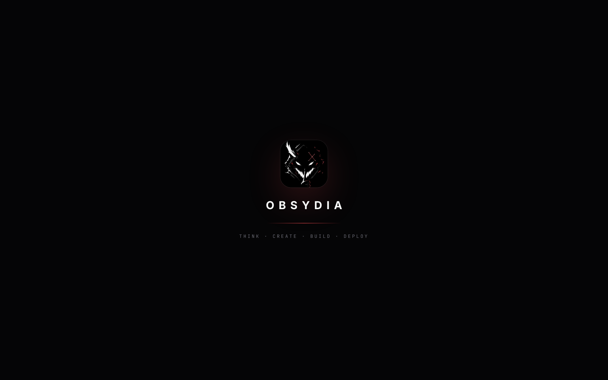 | 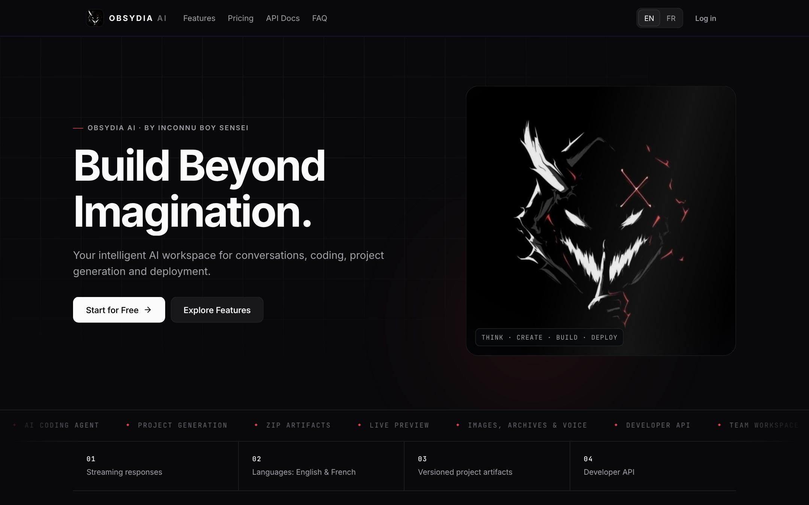 |
| 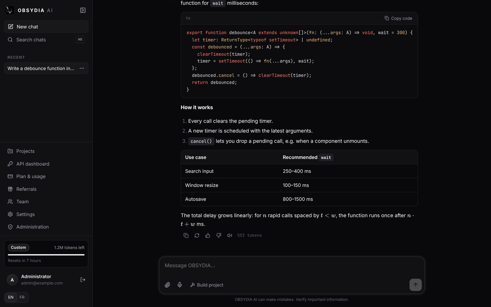 | 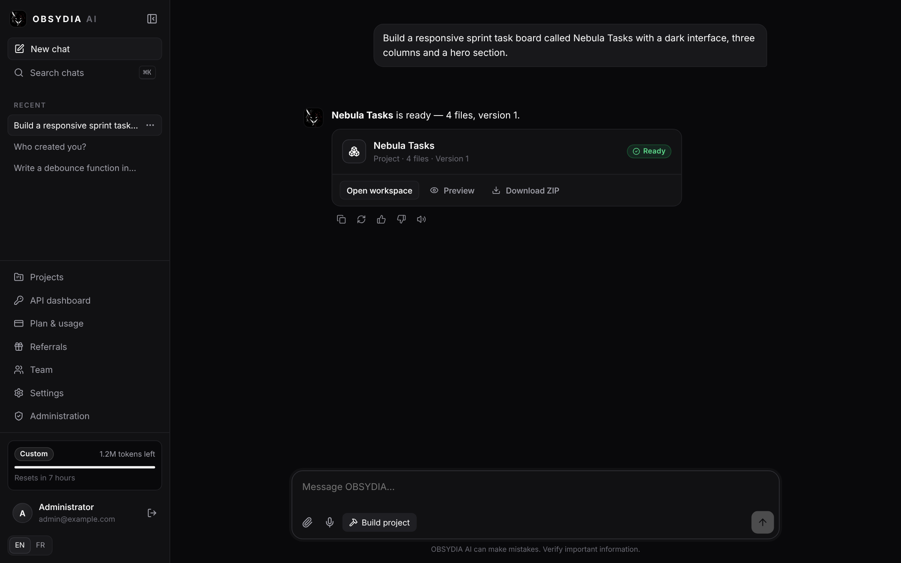 |
| 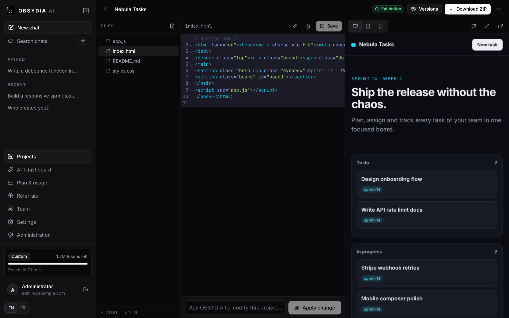 | 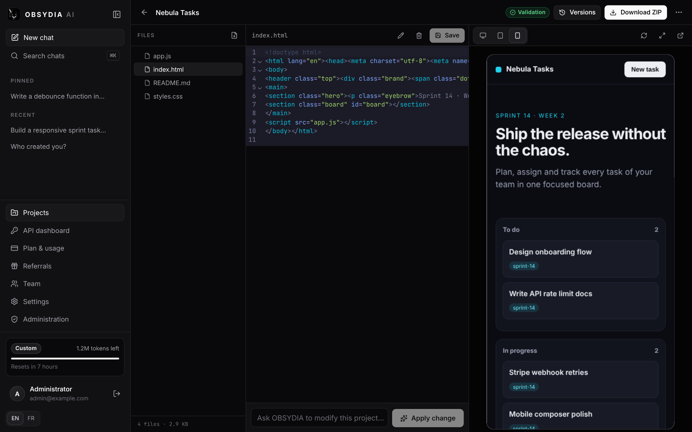 |
| 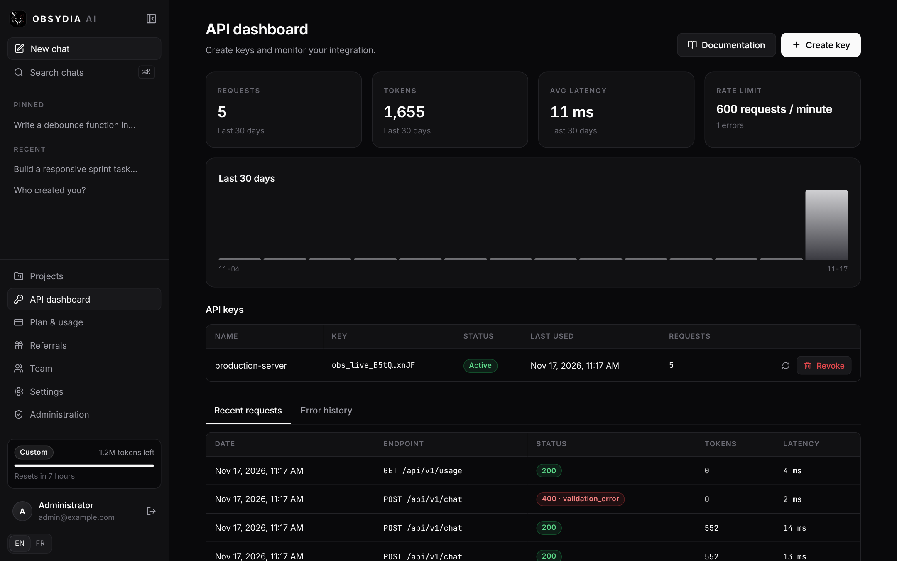 | 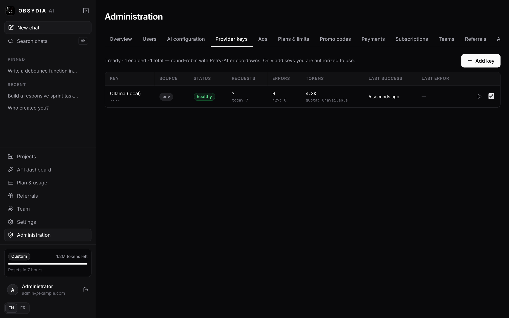 |
| 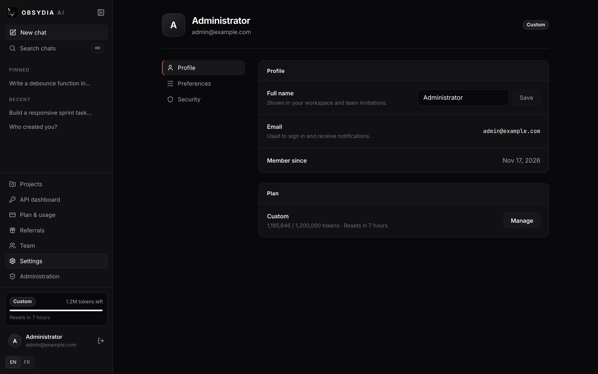 | 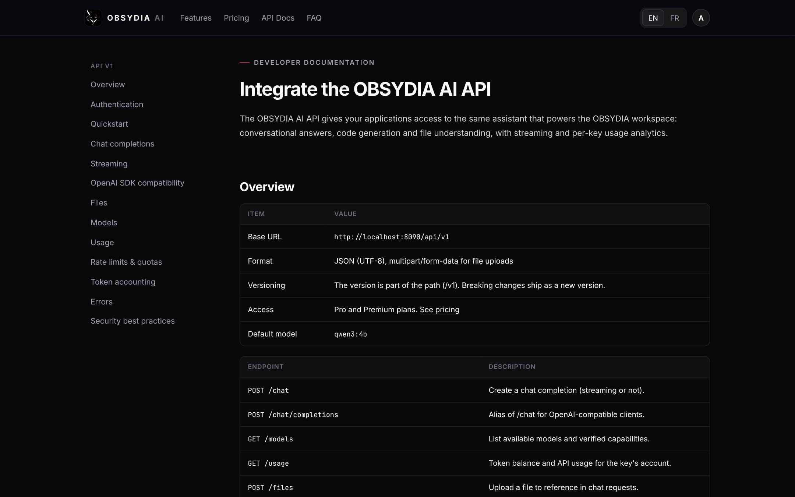 |

<p align="center">
  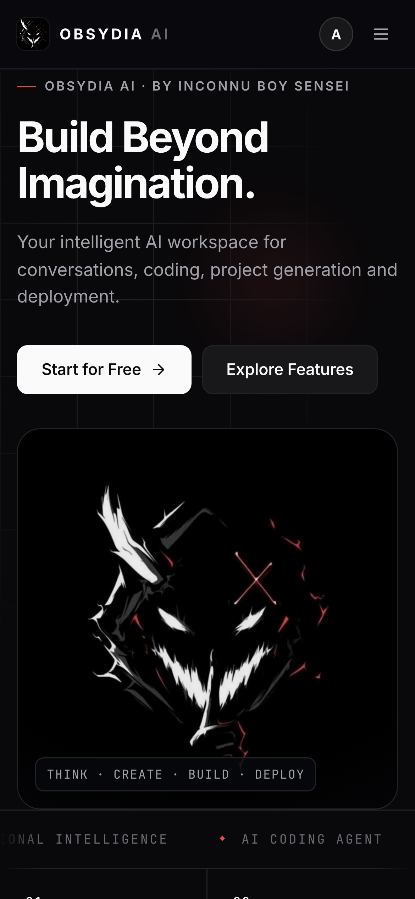
  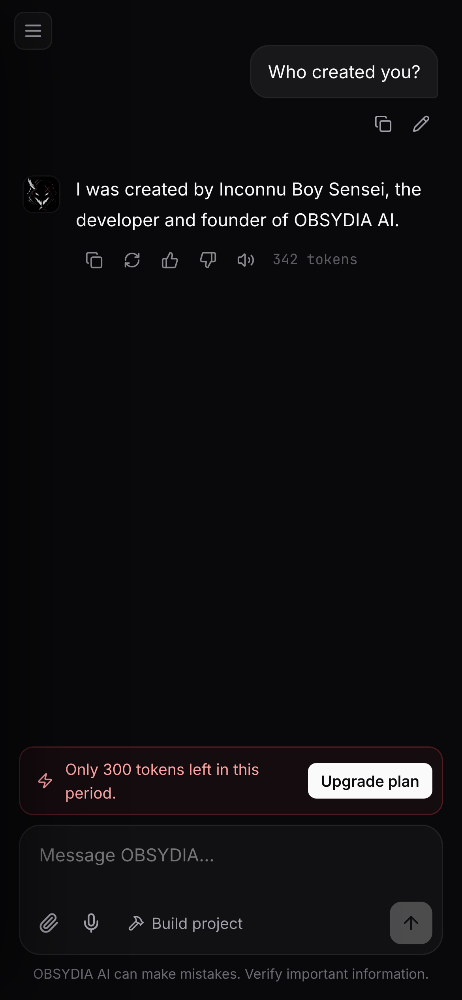
  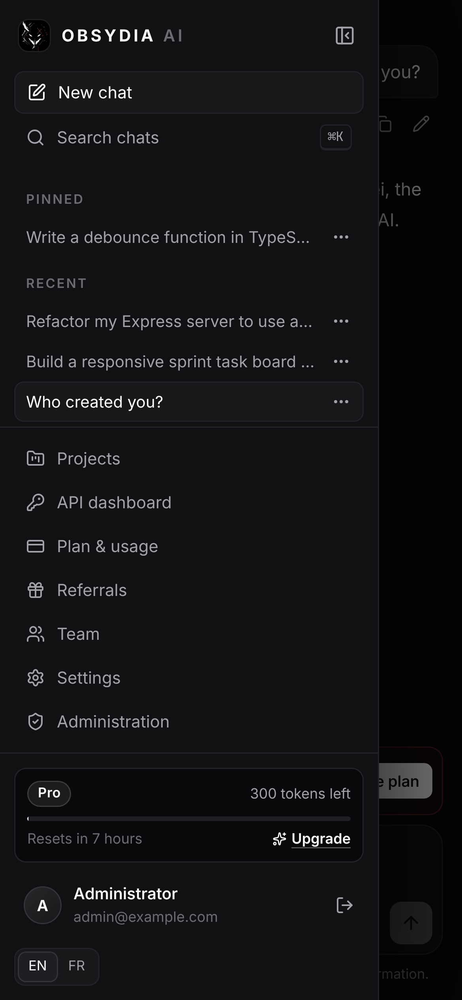
</p>

---

## 🧠 Choosing a model

The installer chooses automatically; you can override it at any time.

| Model | Download | Best for | Suggested hardware |
|---|---|---|---|
| `qwen3:1.7b` | ~1.4 GB | Small VPS, quick answers | 4 GB RAM |
| `qwen3:4b` | ~2.6 GB | **Default** — good balance on CPU | 8–16 GB RAM |
| `qwen3:8b` | ~5.2 GB | Better reasoning and code | 32 GB RAM or 8 GB VRAM |
| `qwen3:14b` | ~9.3 GB | Strongest of the list | 20 GB+ VRAM |
| `qwen2.5-coder:7b` | ~4.7 GB | Code-focused alternative | 16 GB RAM or 8 GB VRAM |

Change the model:

```bash
cd /opt/dark-obsydia-ai
sed -i 's|^OLLAMA_MODEL=.*|OLLAMA_MODEL=qwen3:8b|' .env
docker compose exec ollama ollama pull qwen3:8b
docker compose up -d --force-recreate app
```

To offer several models in the chat model picker, pull them and list them in `AI_MODELS` (comma separated), or edit the list in **Administration → AI configuration** (the *Fetch from provider* button shows the models Ollama has).

On CPU, expect roughly 5–20 tokens per second depending on the model and the processor. A GPU is many times faster. The context window is set with `OLLAMA_CONTEXT_LENGTH` (default 8192).

---

## 🏗 Architecture

```
            Internet
               │
        ┌──────▼──────┐   automatic HTTPS (Let's Encrypt)
        │    Caddy    │
        └──────┬──────┘
               │
   ┌───────────▼────────────┐        ┌────────────────────┐
   │   App (Node.js 22)     │──────▶ │  Ollama  (Qwen3)   │  local model, no API key
   │  Express 5 + React 19  │        └────────────────────┘
   │  /        web app      │        ┌────────────────────┐
   │  /api     session API  │──────▶ │  MongoDB 7         │  users, chats, projects, billing
   │  /api/v1  developer API│        └────────────────────┘
   │  /preview sandboxed    │        volume: uploads + ZIP artifacts
   └────────────────────────┘
```

```
backend/          Express API in TypeScript — config, models, routes, services, tests
frontend/         React + Vite app — pages, components, i18n (en/fr), design system
infrastructure/   Caddy templates (domain / IP)
scripts/          PayPal setup helper
docs/screenshots  Screenshots used in this README
install.sh · update.sh · backup.sh · restore.sh · healthcheck.sh
docker-compose.yml · docker-compose.gpu.yml · Dockerfile · .env.example
```

**Stack:** Node.js 22, Express 5, TypeScript, Mongoose, Zod, React 19, Vite, CodeMirror 6, KaTeX, Ollama, MongoDB 7, Caddy 2, Docker Compose, Vitest.

---

## ⚙️ Configuration

Everything lives in `/opt/dark-obsydia-ai/.env` (see [`.env.example`](.env.example)). The server validates the configuration at startup and refuses to start with a clear message if something is wrong. After editing `.env`:

```bash
cd /opt/dark-obsydia-ai && docker compose up -d --force-recreate app
```

| Variable | Default | Purpose |
|---|---|---|
| `AI_PROVIDER` | `ollama` | `ollama`, `deepseek`, or any name with `AI_BASE_URL` for another OpenAI-compatible API |
| `OLLAMA_MODEL` | `qwen3:4b` | Local model served by Ollama |
| `OLLAMA_CONTEXT_LENGTH` | `8192` | Context window of the local model |
| `AI_MODELS` | — | Extra selectable models, comma separated |
| `AI_DISPLAY_NAME`, `AI_PERSONALITY`, `AI_SYSTEM_PROMPT`, `AI_WELCOME_MESSAGE` | OBSYDIA defaults | Assistant identity (also editable in the admin panel) |
| `AI_MAX_OUTPUT_TOKENS` / `AI_PROJECT_MAX_OUTPUT_TOKENS` | `2048` / `8192` | Answer and project-file limits |
| `DOMAIN`, `ACME_EMAIL` | — | Domain and certificate email for HTTPS |
| `ADMIN_EMAIL`, `ADMIN_PASSWORD` | set by the installer | First administrator |
| `SMTP_*` | — | Email delivery (verification codes, resets, invitations) |
| `STRIPE_*`, `PAYPAL_*` | — | Payments (optional) |
| `FREE_/PRO_/PREMIUM_TOKEN_LIMIT`, `*_RESET_HOURS`, `*_PRICE_USD` | 25k/7d · 60k/7h · 300k/7h | Plans (also editable in the admin panel) |
| `ADS_*`, `COMMUNITY_*` | disabled | Optional ads and community link |

### Email

Users must verify their email to use the app, so configure SMTP for any public instance. With Gmail, enable 2-step verification, create an **App Password**, then:

```env
SMTP_HOST=smtp.gmail.com
SMTP_PORT=587
SMTP_USER=you@gmail.com
SMTP_PASSWORD=your-16-letter-app-password
```

Without SMTP in development, verification codes are printed in the server log.

### Using a cloud API instead of Ollama

```env
AI_PROVIDER=deepseek
AI_API_KEYS=["sk-..."]
```

or any OpenAI-compatible endpoint:

```env
AI_PROVIDER=custom
AI_BASE_URL=https://llm.example.com/v1
AI_MODEL=model-name
AI_API_KEYS=["key-1","key-2"]
```

Multiple keys rotate round-robin with Retry-After cooldowns, and more keys can be added (encrypted) in **Administration → Provider keys**. You can stop the Ollama container in that case: `docker compose stop ollama`.

### Payments

- **Stripe:** set `STRIPE_SECRET_KEY` and add a webhook to `https://your-domain/api/webhooks/stripe` with `checkout.session.completed`, `checkout.session.async_payment_succeeded`, `customer.subscription.created|updated|deleted`, `invoice.paid`, `invoice.payment_failed` and `charge.refunded`; put its signing secret in `STRIPE_WEBHOOK_SECRET`.
- **PayPal:** set `PAYPAL_CLIENT_ID`, `PAYPAL_CLIENT_SECRET` and `PAYPAL_MODE`, then run `sudo ./scripts/paypal-setup.sh`. It creates the product, both monthly plans and the webhook, and saves their IDs.

Plans are only activated after the provider confirms the payment through a signed webhook.

---

## 🔌 Developer API

Pro and Premium users create keys in the **API dashboard**. Full documentation with cURL, Node.js, Python and PHP examples is built into the app at **`/docs`**.

```bash
curl https://your-domain/api/v1/chat \
  -H "Authorization: Bearer $OBSYDIA_API_KEY" \
  -H "Content-Type: application/json" \
  -d '{"messages":[{"role":"user","content":"Write a debounce function in TypeScript"}]}'
```

The chat endpoint follows the OpenAI format, so official SDKs work by changing the base URL:

```js
import OpenAI from "openai";
const client = new OpenAI({ apiKey: process.env.OBSYDIA_API_KEY, baseURL: "https://your-domain/api/v1" });
const res = await client.chat.completions.create({ model: "qwen3:4b", messages: [{ role: "user", content: "Hello" }] });
```

| Endpoint | Description |
|---|---|
| `POST /api/v1/chat` · `POST /api/v1/chat/completions` | Chat completion, streaming with `"stream": true` |
| `GET /api/v1/models` | Available models and capabilities |
| `GET /api/v1/usage` | Token balance and API usage |
| `POST /api/v1/files` · `GET /api/v1/files` · `DELETE /api/v1/files/:id` | Files to attach with `file_ids` |

---

## 🛠 Operations

```bash
cd /opt/dark-obsydia-ai
docker compose ps                  # status
docker compose logs -f app         # application logs
docker compose logs -f ollama      # model server logs
sudo ./update.sh                   # backup → pull latest code → rebuild → check the model → health check
sudo ./backup.sh                   # database + uploads + .env → backups/*.tar.gz
sudo ./restore.sh backups/obsydia-YYYYMMDD-HHMMSS.tar.gz
./healthcheck.sh                   # containers, internal and public health
```

`docker compose down` keeps your data. Never use `docker compose down -v` in production — it deletes the database and the downloaded models.

Daily backup with cron:

```
15 3 * * * root /opt/dark-obsydia-ai/backup.sh --quiet
```

Monitoring: point an uptime checker (UptimeRobot, Better Stack…) at `https://your-domain/health`. It returns `{"status":"ok","database":"connected"}`.

---

## 🧑‍💻 Local development

```bash
git clone https://github.com/INCONNU-BOY-SENSEI/dark-obsydia-ai.git
cd dark-obsydia-ai
npm install
docker run -d --name obsydia-mongo -p 27017:27017 mongo:7.0
docker run -d --name obsydia-ollama -p 11434:11434 -v ollama:/root/.ollama ollama/ollama
docker exec obsydia-ollama ollama pull qwen3:1.7b
cp .env.example .env
```

In `.env`, set:

```env
NODE_ENV=development
APP_URL=http://localhost:5173
MONGODB_URI=mongodb://127.0.0.1:27017/obsydia
OLLAMA_URL=http://127.0.0.1:11434/v1
OLLAMA_MODEL=qwen3:1.7b
JWT_SECRET=<openssl rand -hex 32>
SESSION_SECRET=<openssl rand -hex 32>
ENCRYPTION_KEY=<openssl rand -hex 32>
ADMIN_EMAIL=admin@example.com
ADMIN_PASSWORD=change-me-please-123
```

```bash
npm run dev          # API on :8080, web app on :5173
npm run typecheck
MONGODB_TEST_URI=mongodb://127.0.0.1:27017/obsydia-test npm test
```

The test suite has 67 tests: configuration, encryption, provider rotation and failover, the `<think>` filter, ZIP safety, file detection, emails, and integration tests against a real MongoDB covering authentication, streaming chat, concurrent token accounting, referrals, the developer API, teams, project generation → ZIP → preview → edit → restore, uploads, admin controls and Stripe webhooks.

---

## 🔒 Security

- Passwords hashed with bcrypt; login lockout and rate limits on sensitive routes
- Revocable server-side sessions in httpOnly cookies, CSRF tokens on every state-changing request
- Input validation with Zod and NoSQL-operator stripping
- Strict Content Security Policy, HSTS on HTTPS
- Every resource is owner-checked; team access respects roles
- Uploads detected by content (magic bytes); ZIP archives checked for bombs, path traversal and symlinks
- Generated code only runs in a sandboxed, opaque-origin iframe — never on the server
- API keys stored as SHA-256 hashes, provider keys encrypted with AES-256-GCM
- MongoDB and Ollama are not exposed outside the Docker network
- Audit log for authentication, admin, billing and team events

Found a vulnerability? Please open a private security advisory on GitHub instead of a public issue.

---

## ❓ FAQ

**Does it work without a GPU?**
Yes. The default `qwen3:4b` runs on CPU. Answers are slower than with a GPU but fully usable on a 4-core, 16 GB server.

**The chat says the model was not found.**
The model is still downloading or the download failed. Run `cd /opt/dark-obsydia-ai && docker compose exec ollama ollama pull $(grep ^OLLAMA_MODEL= .env | cut -d= -f2)`.

**Users don't receive verification codes.**
Configure `SMTP_*` in `.env` and restart the app. Check the logs with `docker compose logs app | grep -i email`.

**HTTPS is not active.**
Make sure the domain's A record points to the server and ports 80/443 are open, then check `docker compose logs caddy`.

**Can I rename the assistant or change its personality?**
Yes — in **Administration → AI configuration**, without touching the code.

**Can I use it commercially?**
Yes, under the terms of the Apache 2.0 license. Keep the license and notice files.

---

## 🤝 Contributing

Issues and pull requests are welcome.

1. Fork the repository and create a branch.
2. Run `npm run typecheck` and the test suite.
3. Open a pull request describing the change.

---

## 📄 License

Released under the [Apache License 2.0](LICENSE). See [NOTICE](NOTICE).

<p align="center">
  Made with passion by <b><a href="https://github.com/INCONNU-BOY-SENSEI">Inconnu Boy Sensei</a></b><br />
  <sub>If this project helps you, give it a ⭐ on GitHub.</sub>
</p>
